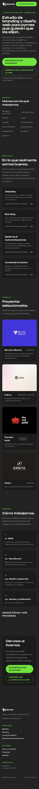
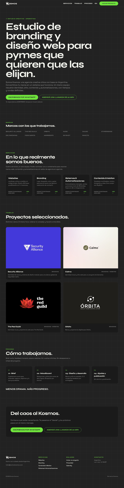
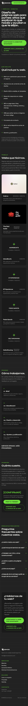
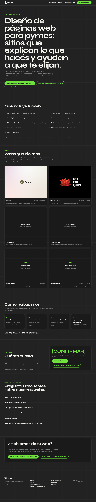

# QA de cierre — 2026-11-10

Sobre `out/` (build `npm run build` OK, TS estricto, 28 rutas + 266 stubs de redirección).
Scripts: `kw_coverage.py`, `copy_lint.py --brand "Somos Kosmos" --allow "Kosmos,SkyShot"` y un
chequeo técnico propio del HTML (H1, title, description, canonical, hreflang, JSON-LD parseable,
links a `#`, links internos rotos, sitemap).

## Páginas con keywords
| Página | Principal en title/H1 | Cobertura | copy_lint | Notas |
|---|---|---|---|---|
| / | ✓ / ✓ | 100% (3/3) | 95 ✅ | 3 keywords descartadas con motivo en `keywords.md` |
| /services/websites | ✓ / ✓ | 86% | 98 ✅ | ✗ "página web para mi negocio" (la página habla de "tu negocio") |
| /services/branding | ✓ / ✓ | 100% | 98 ✅ | "diseño de logo para empresa" descartada |
| /services/systems-automation | ✓ / ✓ | 83% | 97 ✅ | ✗ "automatizar procesos de ventas" (el texto dice "automatizamos … procesos de ventas"; el script no reconoce la conjugación) |
| /services/content-motion | ✓ / ✓ | 100% | 97 ✅ | — |

## Páginas sin keywords (QA técnico + copy)
| Página | copy_lint | Técnico |
|---|---|---|
| /brief | 97 ✅ | OK |
| /privacidad | 99 ✅ | OK · se quitó "formulario de brief" (no existe) |
| /en/ y /en/services/* (5) | 99 ✅ (en conjunto) | OK · `lang="en"` vía postbuild |
| /project/* (11) | no corrido | OK · 7 casos con description de 173–200 caracteres (Google la recorta; no es error) |

## Técnico del sitio
- 1 H1 en las 24 páginas · JSON-LD presente y parseable en todas · 0 links a `#`
- 0 links internos rotos (antes: 12 desde EN hacia `/en/brief/` y `/en/project/*`)
- Sitemap: 23 URLs canónicas (7 ES + 5 EN + 11 casos), sin stubs
- Stubs: `/project/ehtexperience` → `/project/ethperience/`, 264 `/project/<slug>/<topic>`, 4 `/topic/*`,
  todos con `noindex` + meta refresh + canonical

## No verificado en esta pasada
- CTA visible en 360×740 / 390×844 y altura uniforme de cards: no se abrió navegador
- JSON-LD validado como JSON, no en Rich Results Test
- Keywords de la versión EN: no hay `keywords.md` para EN en el plan

---

# Correcciones antes del merge — 2026-11-10 (segunda pasada)

Un commit por punto en `kosmos/web-2026`. Build `npm run build` limpio (TS estricto, 28 rutas).
Verificación con Chrome headless manejado por DevTools Protocol (viewport real, sin iframes).

| # | Corrección | Verificación |
|---|---|---|
| 1 | Overflow del bloque de precios (446px a 360) | `scrollWidth == 360` en **23/23** páginas |
| 2 | Fuera lo que no está en `00-contexto.md` (mantenimiento, datos reales 1–2 semanas, infraestructura, panel/tablero, Slack, OpenAI/Claude, "todo documentado", Next.js, Webflow, etc.) | grep: solo quedan dentro de `[CONFIRMAR: …]`. kw_coverage de servicios sigue ✅ (83–100%) |
| 3 | Casos solo desde `legacy-vite/data/projects.ts` | 11 casos reescritos; Orbita: "Marca y experiencia digital" (lo único que dice la fuente) |
| 4 | Marca una vez en el title | **24/24** `<title>` y `og:title` terminan en " — Somos Kosmos", una sola vez |
| 5 | Logo `logo-light.png` en header/footer + grilla fina de fondo | Capturas abajo |
| 6 | Botón flotante de WhatsApp | A 360×740 en 22 páginas: CTA del hero sin scroll (≤ 639px), flotante oculto mientras se ve, visible después, 0 textos del footer tapados. `/privacidad` no tiene flotante |
| 7 | Borrados `legacy-vite/` y `DEPLOYMENT.md`; README con deploy real | Build limpio sin ellos; `out/CNAME` = somoskosmos.com |

Cambio extra que salió del punto 6: en 4 servicios el CTA del hero quedaba debajo del pliegue a
360×740 (H1 largo en 44px). H1 mobile pasa a 34px y el hero tiene menos padding arriba.

Pendiente menor: las meta descriptions de Orbita (54 car.) y The Red Guild (69 car.) quedan cortas
porque la fuente no dice más; se completan cuando haya datos del caso.

## Capturas (full page)
| | 360 | 1280 |
|---|---|---|
| Home |  |  |
| /services/websites |  |  |

Las capturas se toman con un viewport tan alto como la página, así que el CTA del hero queda
siempre a la vista y el botón flotante no aparece (es lo esperado).
